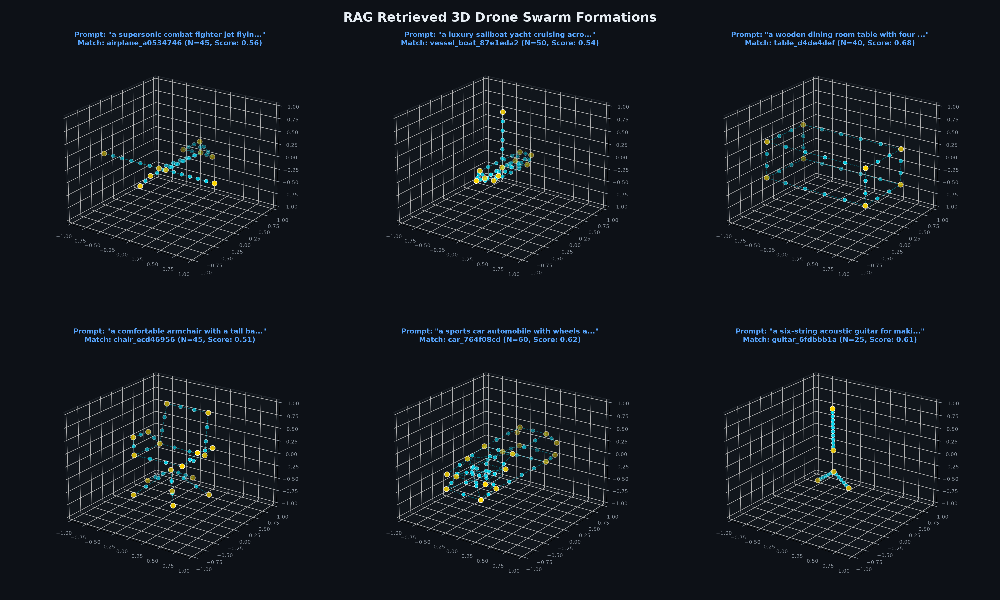
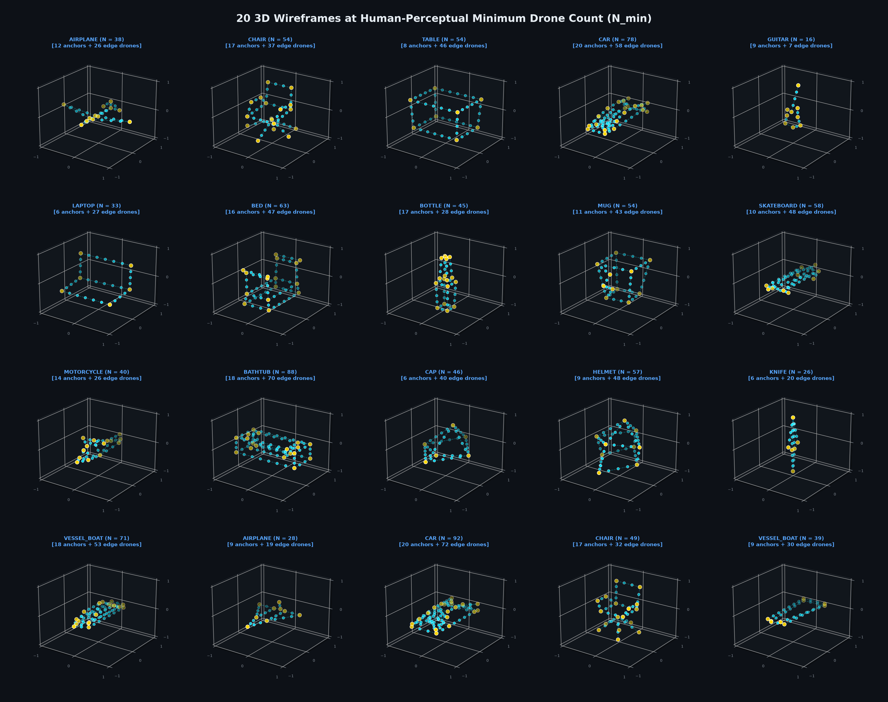

# Text2Swarm 🛸

> Convert natural language prompts into recognizable 3D drone swarm wireframe formations ($N = 15$ to $200+$ drones).

Text2Swarm combines a dataset of **7,450+ clean 3D wireframe models** (derived from KeypointNet) with a **Semantic RAG system** and a **Bottom-Up Subdivision algorithm** to generate drone light show formations from simple text descriptions.

---

## ⚡ Quick Test (CLI)

You can test the RAG swarm generator directly from your terminal using `test_rag.py`. It accepts any natural language prompt, finds the single closest 3D model, and saves the rendered formation directly to `assets/test_rag_output.png`.

```bash
# 1. Run with a custom prompt and drone count
python test_rag.py "a supersonic combat fighter jet" --drones 45

# 2. Or run interactively (will prompt for text & drone count)
python test_rag.py

# 3. Test out-of-domain rejection (returns: 'this formation is not valid')
python test_rag.py "a slice of hot pepperoni pizza"
```

The generated 3D swarm plot is saved automatically to [`assets/test_rag_output.png`](assets/test_rag_output.png).

---

## 📦 Requirements

Only standard, lightweight dependencies are required (runs 100% on CPU):

```bash
conda activate s2f
pip install sentence-transformers torch numpy scipy matplotlib plotly
```

> [!NOTE]
> The `unecessary/` directory contains archived early experiments (such as Point-E diffusion exploration). None of the dependencies for those files (e.g. `point-e`) are required to run Text2Swarm.

---

## 📁 Project Structure

```text
Text2Swarm/
├── test_rag.py                       # CLI test script (prompt -> 3D image in assets/)
├── 01_dataset_generation.ipynb       # KeypointNet extraction & 3D wireframe topology synthesis
├── 02_wireframe_subdivision.ipynb    # Bottom-up anchor + proportional edge subdivision demo
├── 03_rag_swarm_generator.ipynb      # Semantic RAG prompt matching notebook
├── data/
│   ├── keypointnet_wireframes.json   # 7,454 verified 3D wireframe models (≤ 20 keypoints)
│   ├── sample_wireframes.json        # 4 reference CAD models (fighter jet, star, chair, house)
│   └── wireframes_keys.json          # Cached database model index
├── assets/
│   ├── test_rag_output.png           # Output generated by test_rag.py
│   ├── rag_retrieved_swarms_gallery.png  # RAG prompt-to-swarm visual matches
│   ├── samples_20_min_drones_gallery.png # 20 shapes at perceptual minimum drone count (N_min)
│   └── samples_20_wireframes_gallery.png # 20 sample 3D wireframe skeletons
├── unecessary/                       # Archived experiments (Point-E, old plans)
└── outputs/                          # Exported 3D coordinates (.npy, .json, .html)
```

---

## 🎯 Core Features

### 1. Semantic RAG with Out-of-Domain Rejection
* **Dense Text Embeddings:** Vectorizes natural language prompts using `all-MiniLM-L6-v2` (running on CPU).
* **Single Closest Match:** Computes exact cosine similarity across 7,450+ 3D models and returns **only the single closest model**.
* **Validation Guardrail:** If similarity is below `0.30`, the system rejects the query and returns:
  > `this formation is not valid`

### 2. Perceptual Minimum Drone Calculation ($N_{\min}$)
To prevent the **"constellation effect"** (isolated dots in the sky that human eyes cannot connect), the system computes:

$$N_{\min} = K + \sum_{e=(i, j) \in \mathcal{E}} \max\left(0, \left\lceil \frac{\|P_j - P_i\|_2}{d_{\text{gap}}} \right\rceil - 1\right)$$

* Mandatory corner anchors ($K$) are locked first (gold markers).
* Continuous stroke spacing ($d_{\text{gap}} \le 0.25$) places intermediate drones along edges (cyan markers) so human vision traces the 3D shape effortlessly.
* **Drone Count Validation:** If $N < K$, formation is refused (*"target drones < mandatory anchors"*).

### 3. Guaranteed WebGL-Free 3D Visualization
* Renders true 3D perspective views via Matplotlib 3D (`mplot3d`) directly as images—**100% immune to browser/VS Code WebGL errors**.
* Interactive Plotly 3D rotatable viewers are also provided in the notebooks.

---

## 🖼️ Visual Previews

### 1. RAG Prompt-to-Swarm Formations


### 2. 20 Shapes at Perceptual Minimum Drone Count ($N_{\min}$)


---

## 📄 License
MIT License.
